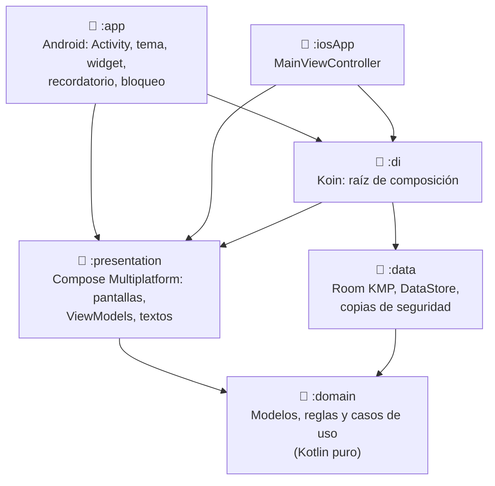
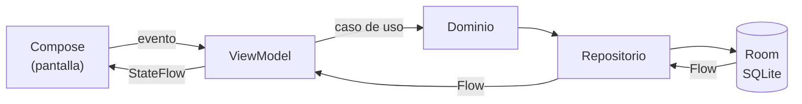

<div align="center">

# 💸 GastosTracker

**Tus gastos, ingresos y ahorros, claros y en tu bolsillo.**
Una app de finanzas personales hecha con Kotlin Multiplatform y Compose, que guarda todo en tu móvil.


</div>

---

## ✨ Qué hace

| | |
|---|---|
| 🧾 **Gastos e ingresos** | Apunta un movimiento en segundos: concepto, importe (con coma o punto), fecha, categoría, nota, método de pago y cuenta. Deslizar para borrar, con deshacer. |
| 📅 **Por meses** | Navega mes a mes (← Noviembre 2026 →). ¿Cobras el 25? Elige el **día de inicio del mes** y todo se calcula del 25 al 24. |
| 🔎 **Búsqueda y filtros** | Busca por concepto o nota y filtra por varias categorías a la vez, por rango de importe o por un rango de fechas propio. |
| 🎯 **Presupuestos** | Límite mensual por categoría (o global) con barra verde → ámbar (80 %) → roja al pasarte. |
| 🔁 **Fijos** | Alquiler, nómina, suscripciones… márcalos como "repetir cada mes" y se apuntan solos el día que toca. |
| 🐷 **Metas de ahorro** | "Viaje a Japón: 1.200 / 3.000 €", con fecha objetivo y cuánto apartar cada mes para llegar. |
| 🏦 **Cuentas** | Banco, efectivo, tarjeta de crédito… cada una con su saldo. |
| 📊 **Gráficos** | Anillo por categoría (toca una sección y verás sus gastos), ingresos frente a gastos, evolución de una categoría, comparativa con el mismo mes del año pasado y ahorro acumulado. |
| 📈 **Resumen del mes** | Al empezar un mes: "En octubre gastaste un 12 % menos; tu categoría más alta fue Hogar". |
| ⚠️ **Alertas** | Te avisa de las categorías en las que gastas más que el mes anterior. |
| 📸 **Ticket con OCR** | Haz una foto del ticket y la app lee el importe total por ti (ML Kit). |
| 🔔 **Recordatorio diario** | "¿Has apuntado tus gastos de hoy?", a la hora que elijas, solo si aún no has apuntado nada. |
| 🏠 **Widget y atajo** | Widget con lo gastado este mes y botón "+ Gasto"; atajo al mantener pulsado el icono. |
| 🔒 **Bloqueo** | Huella, cara o el PIN/patrón del móvil para abrir la app. |
| 💾 **Tus datos son tuyos** | Exporta a **CSV para Excel**, haz una **copia de seguridad** en JSON y restáurala cuando quieras. |
| 🌍 **A tu manera** | Tema claro/oscuro, 14 monedas y formato de importes según el idioma del dispositivo. |

> Sin cuentas, sin servidores, sin anuncios: todo se guarda en una base de datos local en el dispositivo.

---

## 🏗️ Arquitectura

Arquitectura limpia en módulos de Kotlin Multiplatform. Todo, incluida la interfaz, es código común (`commonMain`) que comparten Android e iOS; cada plataforma solo aporta lo suyo (base de datos, selector de archivos, notificaciones, cámara…).



| Módulo | Qué contiene |
|---|---|
| `:domain` | Modelos (`GastoModel`, `Presupuesto`, `Recurrente`, `MetaAhorro`, `Mes`…), reglas de negocio puras y casos de uso. Sin dependencias de plataforma. |
| `:data` | Room (9 versiones de esquema con migraciones probadas), DAOs con agregados en SQL, DataStore para los ajustes, migración desde el formato JSON antiguo y copia de seguridad. |
| `:presentation` | Interfaz en Compose Multiplatform, ViewModels (`StateFlow`), navegación y textos con Compose Resources. Piezas de plataforma con `expect/actual`. |
| `:di` | Arranque de Koin (`iniciarKoin { }`), igual en Android e iOS. |
| `:app` | La app Android: tema Material 3, splash del sistema, widget (Glance), recordatorio (WorkManager) y bloqueo (BiometricPrompt). |
| `:iosApp` | Punto de entrada de iOS (framework para Xcode). |

### Flujo de datos



Los totales, agregados por categoría y saldos se calculan en SQL; las pantallas observan `Flow`s de Room y se actualizan solas.

---

## 🧰 Tecnologías

| Área | Librerías |
|---|---|
| Lenguaje | Kotlin 2.4 (Multiplatform) |
| Interfaz | Compose Multiplatform 1.12 · Material 3 · Navigation Compose · Compose Resources |
| Datos | Room KMP 2.8 + SQLite bundled · DataStore Preferences · kotlinx.serialization |
| Asíncrono | Kotlin Coroutines y Flow · kotlinx-datetime |
| Inyección | Koin 4.2 |
| Android | WorkManager · Glance (widget) · BiometricPrompt · ML Kit Text Recognition · Storage Access Framework |
| Tests | kotlin.test · kotlinx-coroutines-test · Room en memoria · `MigrationTestHelper` |
| Build | Gradle 9.7 · Android Gradle Plugin 9.4 · KSP · R8 |

---

## 🚀 Empezar

### Requisitos

- **Android Studio** reciente (con soporte para AGP 9.4) y **JDK 17** o superior.
- Android SDK 37. La app funciona en **Android 13 (API 33)** o superior.
- Para iOS: un Mac con Xcode (ver [iOS](#-ios)).

### Compilar e instalar

```bash
git clone https://github.com/basd1/GastosTracker.git
cd GastosTracker

# APK de depuración
./gradlew :app:assembleDebug

# Instalar en un dispositivo o emulador conectado
./gradlew :app:installDebug
```

### Tests

```bash
./gradlew :domain:jvmTest :data:jvmTest :presentation:testAndroidHostTest :app:testDebugUnitTest
```

- `:domain` — reglas de negocio (periodos con día de inicio, presupuestos, recurrentes, metas, estadísticas…).
- `:data` — repositorios contra Room en memoria, **todas las migraciones** validadas contra los esquemas exportados en `data/schemas`, migración desde el JSON antiguo y copia de seguridad de ida y vuelta.
- `:presentation` — ViewModels con repositorios falsos en memoria, CSV, lectura de tickets y formato de moneda.

> El target `jvm()` de `:domain` y `:data` existe para poder ejecutar Room con SQLite en el ordenador, sin dispositivo.

### Versión de release

La versión de release usa R8 (código y recursos reducidos). Para firmarla, crea `keystore.properties` en la raíz (**no se sube a git**):

```properties
storeFile=ruta/al/keystore.jks
storePassword=...
keyAlias=...
keyPassword=...
```

```bash
./gradlew :app:assembleRelease
```

Sin ese fichero se genera `app-release-unsigned.apk`. Guarda el keystore y sus contraseñas fuera del repo y con copia: sin ellos no se pueden publicar actualizaciones.

---

## 📂 Estructura

```
GastosTracker/
├── app/            # App Android (Activity, tema, widget, recordatorio, bloqueo)
├── domain/         # Modelos, reglas y casos de uso
├── data/
│   ├── schemas/    # Esquemas de Room exportados (uno por versión)
│   └── src/        # Room, DAOs, repositorios, ajustes, migraciones, copia de seguridad
├── presentation/
│   └── src/
│       ├── commonMain/          # Pantallas, ViewModels, componentes y textos (compartido)
│       ├── androidMain/         # actual: archivos, permisos, cámara, OCR, moneda
│       └── iosMain/             # actual de iOS
├── di/             # Koin
└── iosApp/         # Entrada de iOS
```

---

## 🔐 Datos y privacidad

- Todo se guarda **solo en el dispositivo** (Room + DataStore). La app no tiene servidor ni analítica.
- La copia de seguridad de Android incluye la base de datos, los ajustes y las fotos de los tickets, y solo se sube a la nube si va **cifrada**.
- Desde **Ajustes → Datos** puedes exportar todo a CSV, crear una copia de seguridad JSON o restaurarla (se valida entera antes de sustituir nada).
- El OCR de tickets se hace en el propio móvil con ML Kit.

---

## 🍎 iOS

La interfaz y la lógica ya son comunes y compilan para iOS, pero la app de iOS todavía no se ha montado ni probado en un Mac. Faltan las piezas nativas que en Android sí existen: guardar/abrir archivos, notificaciones, Face ID/Touch ID y cámara/OCR (están marcadas con `TODO(iOS)` en `presentation/src/iosMain`).

---

## 🗺️ Próximamente

- App de iOS completa.
- Traducciones (los textos ya están en recursos, listos para traducir).
- Sincronización entre dispositivos (pendiente de decidir backend).

---

<div align="center">

Hecho con ☕ y Kotlin por [@basd1](https://github.com/basd1)

</div>
